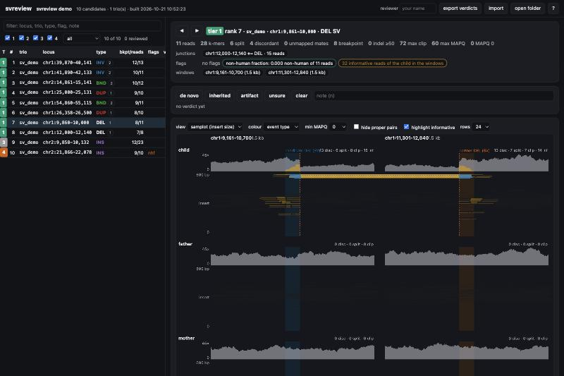

# svreview

A viewer for reviewing the structural-variant candidates of
[kmer_denovo_filter](https://github.com/jlanej/kmer_denovo_filter)'s discovery mode, one candidate at a time:
**both ends of a junction side by side** with the reads that link them drawn across; **the child's informative
reads** (the ones carrying proband-unique k-mers) lit up; **MAPQ and the non-human fraction as colour**; **the
parents' reads at the same windows**, so inherited, de novo and lymphoblastoid-somatic are a glance; **navigation
by the candidate table** (tier, rank, flags) with **a verdict per candidate** - de novo, inherited, artifact,
unsure, and a note - written to a TSV the analysis reads back as a flag.

It runs in the browser from static files: a page, a manifest and the mini-BAMs of each candidate's bundle, read
by range requests. GitHub Pages serves it ([jlanej.github.io/svreview-](https://jlanej.github.io/svreview-/),
with the demo loaded); `svreview serve` serves a review directory at home and writes the verdicts to disk as
they are given; a site folder can also be opened straight from the page, with no server at all.

The input is **one review set** ([docs/FORMAT.md](docs/FORMAT.md)): a directory with the candidate table, a
trios table and the reads per candidate (bundles) or per trio. Any analysis - the 1000 Genomes trio screen,
another cohort's arm, a single trio at home - writes one; `svreview check` says whether it is complete; nothing inside
svreview is specific to any of them.

**Status: 0.1.0, the first version.** The viewer works on the demo (the tool's own simulated trio: the set
under [`examples/sv_demo_review`](examples/sv_demo_review/), the site under [`docs/demo`](docs/demo/)); the
Python side turns a set into a site and reads the verdicts back; the browser's BAM reader is checked record
for record against htslib. The public example on a real 1000 Genomes trio is
[planned](docs/example/README.md), not built.

> **svreview is not samplot.** The picture - coverage split by mapping quality, read pairs as lines at their
> insert size and split reads as dotted lines, coloured by the event their strands imply - follows
> [samplot](https://github.com/ryanlayer/samplot) by Ryan Layer and contributors, and the first draft of the
> renderer was the author's own AI-generated in-browser prototype of it
> ([svplot-js](https://github.com/jlanej/svplot-js)). What is new here is the trio, the two breakpoints, the
> k-mer evidence and the verdicts. For publication figures and for anything beyond this one use case, use and
> cite samplot: Belyeu JR, Nicholas TJ, Pedersen BS, et al. **SV-plaudit: a cloud-based framework for manually
> curating thousands of structural variants.** *GigaScience* 2018;7(7):giy064.
> <https://doi.org/10.1093/gigascience/giy064>.

> **No real data in this repository.** The demo is a simulated trio on a random 90 kb reference; the planned
> example is public 1000 Genomes data. Nothing from a controlled-access cohort - no reads, no identifiers, no
> paths - is ever written here.



## What the viewer shows

| | |
|---|---|
| **windows** | one panel per window of the bundle: the candidate's own region padded, and each junction partner's; two panels for a junction whose ends lie apart (a deletion's two breakpoints, the two chromosomes of a translocation), one when they overlap. The candidate region is shaded blue, a partner region orange. |
| **rows** | child, father, mother, on the same coordinate and depth scales. |
| **coverage** | per window: depth of alignments with MAPQ ≥ 20 (dark) and below (light), and over it the depth of the child's informative reads (orange): the k-mer evidence layer. |
| **samplot view** | every read pair as a line at its insert size, every split read as a dotted line at its span, coloured by event type (black deletion/normal `+ −`, red duplication `− +`, blue inversion `+ +` / `− −`, green between chromosomes); a pair or split with its ends in two windows is drawn across the gutter; proper pairs dimmed; a read whose mate is unmapped gets a ring. |
| **pileup view** | the alignments as bars, soft clips as orange stubs to scale, mates joined, cross-window links as arcs, informative reads first. |
| **the informative reads** | every read of the child that the run's informative BAM holds (`dk:i:1`) carries an orange halo, in both views. |
| **breakpoints** | a dashed line where the child's clipped reads agree (the tool's `breakpoint_reads` rule: ≥ 2 clips within 5 bp). |
| **colour modes** | event type (samplot's), MAPQ (0 light to 60 dark), informative or not, taxon (from an optional per-read sidecar). |
| **the candidate** | tier, rank, locus, type and class; the evidence columns; the junctions (`partner strands type reads`); the flags; the non-human fraction of the region with its top taxon, or why there is none; the count of informative reads in the windows. |
| **the members** | per member, the junction evidence as molecules (discordant pairs, split reads, clipped reads, informative), and one line reading them: the child's only, or a parent too. |
| **the table** | every candidate; filter by tier, by reviewed or not, by text; sort by tier and rank, locus, type, reads, verdict; `j`/`k` walk it. |
| **the verdict** | `1` de novo, `2` inherited, `3` artifact, `4` unsure, `0` clear, `n` note; kept in the browser, written to the server when there is one, exported as a TSV (`e`). |

## The input: a review set

[docs/FORMAT.md](docs/FORMAT.md) is the specification; [`examples/sv_demo_review`](examples/sv_demo_review/)
is a complete set. In short:

```
<set>/
  svreview.json      {"format": 1, "title": ..., "pad": 10000}
  candidates.tsv     one row per candidate region: trio chrom start end (required), class, sv_type, the
                     evidence counts, junctions (partner|strands|type|reads), flags, review_tier, rank, nhf
  trios.tsv          one row per trio: trio child father mother, child_sex, and where its files are - per-trio
                     alignments (instead of bundles), the run's metrics.json, its informative BAM, a reference
  bundles/<trio>/<chrom>_<start>_<end>/   child/father/mother as CRAM (reference embedded) or BAM, candidate.json
  verdicts.tsv       what the review writes back
```

The 1000 Genomes trio screen's table and bundles are this layout already; a table of junction pairs (another
arm's) becomes it by writing one row per end; per-trio minified CRAMs stand in for bundles through
`trios.tsv`. Coordinates are BED's (0-based, half-open); `.` is missing, never 0; nothing is ever dropped.

## Use

```bash
pip install git+https://github.com/jlanej/svreview-        # Python ≥ 3.9, pysam
# or: python -m venv .venv && . .venv/bin/activate && pip install -e '.[test]'

svreview check  <set> [--deep]                  # what is there, what is missing; exit 1 on an error
svreview site   <set> --out <site> [--ref FA]   # BAMs for the browser, the informative reads tagged, one manifest
svreview serve  <site> --open                   # review; verdicts appended to <site>/verdicts.tsv as they are given
svreview verdicts --verdicts <site>/verdicts.tsv --candidates <set>/candidates.tsv --out <set>/candidates.verdicts.tsv

# a set from one kmer-discovery run (a cohort's table comes from the screen itself)
svreview candidates --run out/KID.discovery --trio KID --out set/candidates.tsv [--sex 2] [--classes SV,AMBIGUOUS]
svreview bundle --candidates set/candidates.tsv --child kid.cram --father dad.cram --mother mom.cram \
    --ref ref.fa --out-dir set/bundles --pad 10000 [--tier 1,2] [--cram]   # --cram: self-contained CRAMs
#   then set/trios.tsv by hand (trio, child, father, mother; metrics and informative under runs/) and svreview check
```

`svreview site` also takes the pieces as flags (`--candidates --bundles --trios --metrics --informative`) for a
run without a set directory. The viewer takes `?data=<url of the manifest's directory>` (default `demo`, the
demo beside the page) and `&c=<trio>/<chrom>_<start>_<end>` for the candidate; **open folder** loads a site
directory from disk (the browser reads the files directly, nothing is uploaded), for a review on a laptop with
no server. `--with-viewer` copies the page beside the manifest, so a site directory is complete in itself.

## The demo

[`examples/sv_demo_review`](examples/sv_demo_review/) is kmer_denovo_filter's
[`examples/sv_demo`](https://github.com/jlanej/kmer_denovo_filter/tree/main/examples/sv_demo) as a review set:
a random two-chromosome reference (60 kb and 30 kb), 2×150 bp pairs at 30×, the parents reference-only, the
child heterozygous for a 2 kb deletion, a 1.5 kb tandem duplication, a 2 kb inversion, a reciprocal chr1/chr2
translocation, a 55 bp and a 250 bp novel insertion and an SNV. `kmer-discovery` reports the six junctions
(DEL, DUP, INV × 2, BND × 2) and the two insertions; the non-human screen ran with a toy kraken2 database (the
reference as *Homo sapiens*, the 250 bp insertion as *Escherichia coli*), so one candidate carries the `nhf`
flag with its taxon, as a contaminant would. Ten candidate rows (the seven junction ends and the two
insertions), six CRAM bundles with the reference embedded (the two ends of a pair share one), 700 bp of
padding: the deletion's and the inversion's ends sit in two panels, the duplication's in one.
[`docs/demo`](docs/demo/) is `svreview site` on it.

```bash
scripts/make_demo.sh          # rebuilds both in the pinned image (docker); or, with kmer-discovery on PATH:
svreview demo --set examples/sv_demo_review --out docs/demo --kmer-denovo-filter /path/to/kmer_denovo_filter
```

## Design

**CRAM or BAM.** The bundles are CRAMs (the analysis cuts them where the reference is, and a CRAM is a third
the size). The browser could decode them - `@gmod/cram` does - but a CRAM cut against GRCh38 without an
embedded reference needs the reference's bases at every window, which means shipping a slice of the reference
per bundle (a new piece of the contract) or a 3 GB FASTA behind a static site. svreview converts every member
to BAM at site-build time instead (`svreview site`, one pysam pass per member, the reference at hand there,
or embedded in the CRAM, as the trio screen's bundles have it and as `svreview bundle --cram` writes it: self-contained, naming no file). A mini-BAM is a
few MB, self-contained, and what every other tool reads too; the CRAMs stay as the archival copy.

**No build step.** The page is plain HTML, CSS and ES modules; the BAM reader is its own (`docs/js/bgzf.js`,
`bai.js`, `bam.js`: BGZF blocks inflated by the browser's `DecompressionStream`, the index's chunks for a
region, records parsed as the SAM specification lays them out) and is checked against pysam's reading of the
same files (`tests/js`). svplot-js took `@gmod/bam` through webpack; here nothing is bundled, so the repository
is what the browser runs, and the whole viewer serves from a directory.

**One input format, one manifest.** The analysis writes a review set; `svreview site` joins it into
`manifest.json` (contract version 1): per candidate the typed row, the windows that were cut (0-based,
half-open), the members' BAMs with their read counts and the count of informative reads, the region metrics
and the non-human fraction of the region and its partners, and the original row. The viewer reads nothing
else, and svreview adapts to no arm: the set is the adapter, and `svreview check` is its test.

**The picture.** samplot's, by design: reviewers know it. The additions follow the questions a reviewer of
this tool's output asks. Are both breakpoints real, and do the same molecules join them (the two panels, the
reads drawn across)? Is the evidence the k-mers' (the halo, the orange coverage)? Could the reads be mapping
noise (MAPQ as colour, the `mapq0_only` flag) or contamination (the non-human fraction, the taxon colour)? Do
the parents show it (the rows; the member line)?

**Verdicts.** The page keeps them in the browser (per manifest), writes each one to `verdicts.tsv` beside the
manifest when the server takes a POST (`svreview serve`), and exports the same TSV; an import merges a TSV
from elsewhere (the newest `reviewed_at` wins). The analysis reads the merged columns as a flag; nothing is
ever dropped on the viewer's say-so.

## Layout

```
docs/                 the static site (GitHub Pages): index.html, js/, css/, demo/, FORMAT.md, example/ (the plan)
examples/             sv_demo_review: a complete review set, the demo's input
src/svreview/         contract.py (the tables), review_set.py (the set: open, resolve, check), candidates.py (the
                      table of one run), bundle.py (the cut), site.py (the manifest and the BAMs), serve.py
                      (range requests, verdict POST), cli.py, demo.py
tests/                pytest: the contract, the set, the table, the cut, the site, the server, the verdicts
tests/js/             node --test: the BAM reader against pysam fixtures; browser.html runs the same checks in a browser
scripts/              make_demo.sh (the demo in the pinned image), toy_kraken2_library.py
```

Tests: `pytest -q` (Python) and `node --test tests/js` (the reader; node ≥ 18); CI runs both and checks the demo
is complete. `svreview serve . --path tests/js/browser.html` runs the reader's checks in a browser.

## Conventions

- No real data in the repository, ever; no local or remote paths in code, docs or tests (inputs come from
  arguments). The demo is simulated; the example is public.
- The viewer never filters: every candidate of the table is listed, flags and all; a verdict is a column, not a
  drop.
- Coordinates are kept as the files have them (BED 0-based half-open in the tables and the manifest; samtools
  regions 1-based in `candidate.json` and on screen).
- MIT licence.
